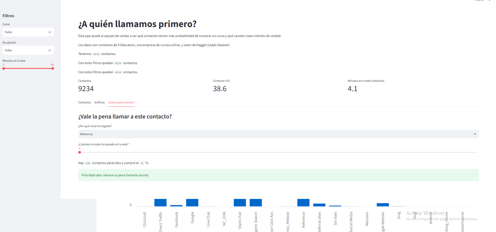
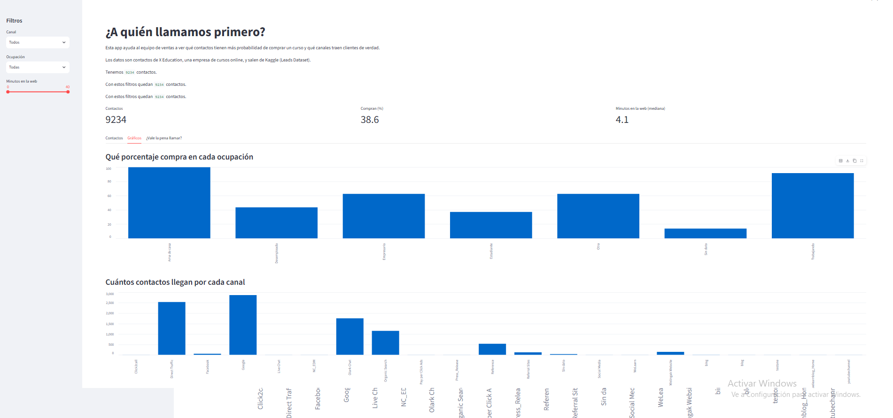

# ¿A quién llamamos primero?

Un análisis de los contactos de una empresa de cursos online para que el equipo de ventas sepa a quién llamar primero.

## La pregunta

¿Qué contactos tienen más probabilidad de acabar comprando un curso y qué canales traen clientes de verdad? Le interesa al equipo de ventas y a la dirección comercial, para no perder tiempo llamando a contactos que no van a comprar.

## Los datos

- De dónde salen: [Leads Dataset, en Kaggle](https://www.kaggle.com/datasets/ashydv/leads-dataset)
- Cuántos son: 9.240 filas y 37 columnas. Después de limpiarlos, 9.234 filas y 13 columnas.
- Qué es cada fila: un contacto (lead) que ha mostrado interés en los cursos de X Education.

## Qué he limpiado y por qué

- Me he quedado con 12 de las 37 columnas, las que sirven para mis preguntas.
- He quitado las columnas que rellena el comercial después de llamar (Tags y Lead Quality), porque yo quiero saber a quién llamar antes.
- He rellenado los huecos de visitas y páginas por visita con la mediana, porque faltaban muy pocos.
- En las columnas de texto he puesto "Sin dato" en los huecos, para no perder casi un 30 % de los contactos ni inventarme nada.
- "Select" era un hueco disfrazado (la persona no eligió nada en el formulario) y lo he cambiado por "Sin dato".
- He juntado "google" con "Google", porque era el mismo canal escrito distinto.
- He pasado el tiempo en la web de segundos a minutos, para que se entienda mejor.
- He quitado 6 contactos con más de 50 visitas, porque eran errores (uno tenía 251 visitas en menos de un minuto).

## Lo que he encontrado

1. Los que están trabajando compran el 91,6 %, más del doble que los desempleados (43,6 %). Los que no dicen su ocupación son los que menos compran: el 13,8 %.
2. Los que compran pasan mucho más tiempo en la web: de mediana 13,9 minutos, frente a 3 minutos los que no compran.
3. Los que llegan recomendados por otra persona compran el 91,8 %, mientras que el chat trae muchos contactos pero solo compra el 25,5 %.

## La app

En la barra de la izquierda puedes filtrar por canal, por ocupación y por minutos en la web, y ver cuántos contactos quedan, qué porcentaje compra y cuántos minutos pasan en la web. En la pestaña de gráficos se compara cuánto compra cada ocupación y cuántos contactos trae cada canal. En la última pestaña eliges el canal y los minutos de un contacto nuevo, y la app te dice si vale la pena llamarle mirando cuántos contactos parecidos compraron.

Enlace: (si la publico en Streamlit Community Cloud)

## Cómo ejecutarlo

1. Crear un entorno e instalar las librerías: `pip install -r requirements.txt`
2. El EDA está en `eda.ipynb`.
3. La app se abre con `streamlit run app.py`.

## Autor

Valeria Ciriza. GitHub: [ValeriaCiriza](https://github.com/ValeriaCiriza)
